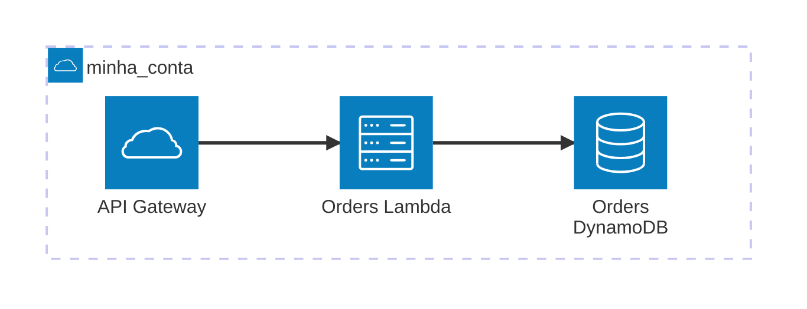

# AWS Architecture Discovery

Aplicação Go com arquitetura hexagonal para unir inventário AWS e dependências APM em um grafo e gerar Mermaid, CSV para draw.io ou JSON orientado a C4. Um único executável atende CLI, tarefa ECS e Lambda. O código não consulta valores de parâmetros SSM, mensagens ou registros de tabelas.

## Executar localmente

Requer Go 1.27 (versão registrada no `go.mod`) e credenciais AWS válidas para os modos `aws` e `hybrid`.

```sh
make build
cp config.example.yaml config.yaml
# Ajuste AWS_REGION e, opcionalmente, AWS_PROFILE no arquivo.
make run
# Ou: ./bin/discovery -config config.yaml
```

O arquivo resultante será `./diagrams/architecture.mermaid`. `OUTPUT_DESTINATION` é um **diretório ou prefixo S3**, não um nome de arquivo. A execução seguinte substitui o artefato do mesmo formato. Escritas locais usam arquivo temporário privado e rename atômico. Para histórico no S3, habilite versionamento no bucket.

```sh
DISCOVERY_MODE=hybrid OUTPUT_FORMAT=drawio-csv \
DD_ENV_TARGET=production ./bin/discovery -config config.yaml
```

Selecione a fonte no `config.yaml`:

```yaml
DISCOVERY_MODE: HYBRID # AWS, DATADOG ou HYBRID
```

Ou sobrescreva pelo ambiente: `DISCOVERY_MODE=DATADOG make run`. `AWS` coleta apenas infraestrutura, `DATADOG` coleta apenas dependências APM e `HYBRID` combina as duas fontes.

Forneça `DD_API_KEY` e `DD_APP_KEY` pelo ambiente ou injeção de segredos. Não coloque chaves em arquivos versionados. Para usar somente Datadog, configure `DISCOVERY_MODE=datadog`; credenciais AWS só serão necessárias se o destino for S3.

## Configuração

Variáveis de ambiente prevalecem sobre YAML, que prevalece sobre os padrões. `make run` carrega `config.yaml` por padrão; use `make run CONFIG=outro.yaml` para outro arquivo. Na execução direta do binário, indique `-config config.yaml`. Erro de leitura encerra a execução. Para configuração apenas por variáveis de ambiente, use `make run CONFIG=`.

| Variável | Padrão / finalidade |
|---|---|
| `DISCOVERY_MODE` | `AWS`, `DATADOG` ou `HYBRID`, sem distinção entre maiúsculas e minúsculas; padrão `AWS` |
| `OUTPUT_FORMAT` | `mermaid`, `mermaid-architecture`, `drawio-csv`, `c4-json`; padrão `mermaid` |
| `OUTPUT_DESTINATION` | `./diagrams/` ou `s3://bucket/prefix/` |
| `AWS_REGION` | Obrigatória para AWS e escrita S3 |
| `AWS_ACCOUNT_NAME` | Nome exibido para a conta varrida; padrão `aws_<ID da conta>` |
| `AWS_ACCOUNT_NAMES` | Mapa YAML opcional de IDs de contas referenciadas para nomes |
| `IGNORE_COMPONENTS` | Lista YAML opcional de componentes excluídos; no ambiente, valores separados por vírgulas |
| `AWS_PROFILE` | Perfil do provedor padrão, incluindo SSO na CLI |
| `TARGET_ACCOUNT_ROLE_ARN` | AssumeRole opcional para o inventário |
| `DD_API_KEY`, `DD_APP_KEY` | Credenciais da API Datadog |
| `DD_SITE` | `datadoghq.com`; aceita os sites públicos e governamentais conhecidos |
| `DD_ENV_TARGET` | Ambiente obrigatório para coleta Datadog |
| `DISCOVERY_TIMEOUT` | `10m`, limite total por execução |
| `DD_TRACE_ENABLED` | `false` na CLI, `true` em Lambda/ECS |

O provedor padrão do SDK obtém credenciais de ambiente, arquivos, SSO ou execution/task role. O código não solicita perfis explicitamente em cloud; evite configurar `AWS_PROFILE` em Lambda/ECS. A role opcional da conta alvo é usada **somente para discovery**. A escrita S3 utiliza a identidade original de execução, permitindo guardar o resultado na conta de automação.

## Diagrama Mermaid Architecture

Para gerar a sintaxe `architecture-beta` em vez de `flowchart`, configure:

```yaml
OUTPUT_FORMAT: mermaid-architecture
```

Ou execute `OUTPUT_FORMAT=mermaid-architecture make run`. O artefato será `architecture.architecture.mermaid` no diretório ou prefixo de saída configurado, separado do flowchart `architecture.mermaid`.

Este formato requer um visualizador compatível com **Mermaid 11.1+**, conforme a [documentação oficial de Architecture](https://mermaid.ai/open-source/syntax/architecture.html). O exportador cria um grupo `cloud` por conta AWS, usando `AWS_ACCOUNT_NAME` para a conta varrida e `AWS_ACCOUNT_NAMES` para outras contas referenciadas. Sem nome configurado, usa `aws_<ID da conta>`. Serviços APM mesclados com recursos AWS ficam no grupo da conta; os demais ficam em `Observed services`. Os ícones usados são os nativos (`server`, `cloud`, `database`, `disk`), sem exigir registro de um pacote de ícones AWS.

Exemplo ilustrativo com identificadores simplificados; o exportador usa identificadores derivados dos IDs dos recursos:



Conexões repetidas entre os mesmos serviços são consolidadas visualmente. O tipo e a fonte de cada relação são preservados em comentários `%%` no arquivo, sem rótulos visíveis nas arestas, para manter compatibilidade com a sintaxe inicial de Architecture. Para compatibilidade com parsers antigos de Architecture, os rótulos usam letras ASCII, números, sublinhados e espaços; pontuação e caracteres acentuados são substituídos por espaços. A saída textual é determinística; a disposição visual depende da versão e do motor de layout do visualizador. O formato `mermaid` continua disponível como flowchart com rótulos nas relações.

## Ignorar componentes e nomear contas

Exemplo de configuração:

```yaml
OUTPUT_FORMAT: mermaid-architecture
AWS_ACCOUNT_NAME: minha_conta
IGNORE_COMPONENTS:
  - certificate
  - rules
  - ssm-parameters
# Opcional: nomes de outras contas encontradas nas referências.
AWS_ACCOUNT_NAMES:
  "222222222222": conta_integracoes
```

A conta varrida será apresentada como `group minha_conta(cloud)[minha_conta]`. O ID da conta é obtido pela identidade AWS usada no discovery, inclusive quando `TARGET_ACCOUNT_ROLE_ARN` está configurado. ARNs sem campo de conta, como os do API Gateway, são associados à conta varrida. Referências cujo ARN pertence a outra conta ficam em outro grupo. Não é necessário conceder permissões adicionais de IAM ou Organizations para consultar nomes: os nomes são fornecidos na configuração. Nomes incompatíveis com a sintaxe Mermaid são normalizados e contas com nomes iguais recebem identificadores distintos.

`IGNORE_COMPONENTS` é opcional e vale para **todos os formatos de saída**. O filtro remove os nós correspondentes e suas conexões depois da resolução de identidades AWS/APM. Sem a opção ou com `[]`, nenhum componente é excluído. A coleta continua consultando as APIs; a opção filtra o artefato, não reduz as permissões necessárias.

Os seletores não diferenciam maiúsculas de minúsculas e correspondem ao tipo do nó, serviço AWS, tipo de recurso no ARN ou combinação `serviço:tipo`:

| Seletor | Efeito |
|---|---|
| `certificate` ou `certificates` | Exclui recursos `certificate/...`, como certificados ACM |
| `rule` ou `rules` | Exclui recursos `rule/...`, como regras EventBridge |
| `ssm-parameter`, `ssm-parameters` ou `ssm parameters` | Exclui parâmetros SSM, mantendo outros tipos do serviço |
| `ssm` | Exclui todos os recursos do serviço SSM |
| `events:rule` | Exclui apenas recursos `rule` do serviço `events` |
| `lambda`, `ecs-task`, `apm-service` | Exclui os respectivos tipos de componente |

O filtro não compara nomes individuais nem usa correspondência parcial. Exemplo pelo ambiente:

```sh
IGNORE_COMPONENTS=certificate,rules,ssm-parameters AWS_ACCOUNT_NAME=minha_conta make run
```

## Pipeline e organização

```text
cmd/discovery                  composição das dependências e detecção do runtime
internal/config                Viper e validação
internal/application           caso de uso e portas Provider, Renderer, Sink
internal/domain                grafo em memória e resolução de identidades
internal/adapter/aws           AWS SDK v2, inventário e relações estáticas
internal/adapter/datadog       API pública de dependências APM
internal/adapter/render        Mermaid, draw.io CSV e C4 JSON
internal/adapter/storage       arquivos locais e S3
internal/adapter/telemetry     instrumentação nativa dd-trace-go
```

O motor de grafos é implementado no domínio com mapas de nós e arestas, sem dependência de SysGraph: o requisito permite um motor equivalente. O domínio não importa SDKs, Viper ou Datadog. Coletores e renderers são selecionados no composition root.

A identidade estrutural usa ARN; tópicos Kafka usam cluster + nome. Um serviço APM é mesclado apenas quando `service`/`env` nas tags AWS ou `DD_SERVICE`/`DD_ENV` na configuração identificam um único recurso. Colisões e ambientes diferentes permanecem separados. Nomes parecidos não são evidência suficiente. O filtro `DD_ENV_TARGET` se aplica à fonte Datadog; o inventário AWS continua abrangendo a região da conta selecionada.

Relações estáticas incluem Lambda Event Source Mappings, SNS subscriptions, integrações REST/HTTP/WebSocket do API Gateway, fontes Lambda/DynamoDB do AppSync e referências explícitas a ARNs/URLs em configurações Lambda/ECS. Variáveis e segredos de configuração não são exportados. Referências apenas por nomes curtos ou por expressões dinâmicas não são inferidas.

Os nós e arestas são ordenados e deduplicados. Rótulos visuais são escapados. A mesma topologia gera o mesmo conteúdo, sem timestamps variáveis. Uma falha de coleta impede a publicação de um desenho parcial. O SDK faz até três tentativas; Datadog repete 429/5xx até três vezes, com espera crescente e cancelamento. O timeout HTTP é 30 segundos e o contexto limita toda a execução.

## Cobertura e limites das fontes

| Fonte | Cobertura |
|---|---|
| Tags AWS | Recursos retornados por Resource Groups Tagging API; complementam as listagens específicas |
| Lambda | Funções, configuração, event source mappings |
| ECS | Clusters, serviços, tarefas em execução e container instances; referências de task definitions |
| API Gateway | APIs REST e v2, integrações e referências a recursos inventariados |
| AppSync | GraphQL APIs e referências a Lambda/DynamoDB em data sources |
| SQS / SNS | Filas, tópicos e subscriptions com destino ARN |
| MSK | Clusters provisionados/serverless; tópicos em provisionados compatíveis |
| DynamoDB / SSM | Tabelas e metadados de parâmetros, sem conteúdo |
| Datadog | Serviços e arestas `calls` retornados pelo endpoint de dependências |

A [API Datadog de dependências](https://docs.datadoghq.com/api/latest/service-dependencies/get-all-apm-service-dependencies/) está em beta e retorna relações por serviço, com janela padrão de uma hora. Ela não fornece um inventário garantido de operações RPC, tabelas, publishers/subscribers ou TPS. Esses componentes só aparecem quando representados como serviços pela instrumentação APM. O projeto não inventa detalhes ausentes e não implementa o enriquecimento opcional de métricas. Use as permissões APM restritas indicadas para sua organização (`apm_dependencies_read` e, quando aplicável, `apm_service_map_read`); um 403 é apresentado como erro, sem tentar escopos mais amplos.

A [API MSK ListTopics](https://docs.aws.amazon.com/msk/latest/developerguide/msk-list-topics.html) é limitada a clusters provisionados compatíveis (Kafka 3.6+). Serverless e versões anteriores entram como clusters e produzem um aviso de ausência do inventário de tópicos; tópicos evidenciados por mappings Lambda ainda podem aparecer. Não há conexão direta a brokers Kafka externos. Recursos sem atividade APM não ganham arestas de runtime automaticamente.

O modo `c4-json` usa o schema versionado `aws-architecture-discovery/c4-v1`: elementos `container` com tecnologia AWS e relações com origem da evidência. Não é o formato de workspace Structurizr nem uma classificação automática de sistemas/pessoas. O CSV do draw.io preserva conectividade, mas não os rótulos individuais das arestas; Mermaid e JSON preservam tipo e fonte. Importe CSV por **Arrange → Insert → Advanced → CSV**, incluindo as linhas de configuração.

## AWS: permissões e implantação

- `deployments/discovery-read-policy.json`: permissões de metadados realmente usadas. Inclui ECS, AppSync e tópicos MSK, que não estavam na matriz inicial. A região é controlada na configuração; ações de listagem usam `Resource: "*"`.
- `deployments/output-policy.example.json`: exemplo de `s3:PutObject` restrito ao prefixo; substitua o nome do bucket. Bucket com SSE-KMS pode exigir permissões adicionais na chave.
- AssumeRole exige `sts:AssumeRole` restrito ao ARN da role alvo e trust policy correspondente. A role alvo recebe a política de leitura; a identidade original recebe a política de saída.
- `sts:GetCallerIdentity` é usado para obter conta/partição e não exige uma concessão IAM explícita.

```sh
make lambda
sam validate --lint --template-file deployments/template.yaml
sam deploy --guided --template-file deployments/template.yaml
```

O template SAM usa bucket existente, Lambda ARM64, timeout de 15 minutos, concorrência reservada 1, EventBridge diário e `POST /discover` protegido por AWS IAM. A implantação é manual; nenhum recurso foi criado automaticamente. SAM adiciona permissões de logging e invocação aos recursos gerados. Para execuções longas, o timeout síncrono do API Gateway pode expirar antes do discovery: prefira o agendamento ou invocação Lambda assíncrona. O artefato é escrito no S3, não retornado no corpo da API.

Para ECS, construa a imagem do `Dockerfile`, execute como tarefa com task role de leitura e destino S3, e use EventBridge Scheduler com alvo `RunTask` quando precisar de agendamento. O processo executa uma varredura e termina; não mantém um servidor HTTP. Dimensionamento inicial de 512 MiB na Lambda é apenas um ponto de partida: valide memória, duração e custo na conta real.

## Observabilidade

O motor usa `dd-trace-go/v2` diretamente, com spans de execução e de coleta, contagens de nós/arestas, erros e logs JSON via `slog`. Não usa uma ponte OpenTelemetry. Os identificadores de trace/span são incluídos no log de sucesso. Há flush ao final de cada invocação Lambda e Stop na CLI/ECS.

A [biblioteca Go do Datadog](https://docs.datadoghq.com/tracing/trace_collection/automatic_instrumentation/dd_libraries/go/) precisa de um destino de ingestão de traces: configure Agent em ECS/CLI ou a extensão Datadog na Lambda. A instrumentação no código não substitui o transporte. O template permite informar `DatadogExtensionLayerArn`; injete a chave/secret e demais configurações de ingestão conforme seu ambiente. Sem Agent/extensão configurado, a geração do desenho funciona, mas a entrega dos traces não está garantida. As credenciais para ler a API APM são independentes desse transporte.

## Uso como package em outra aplicação Go (proposta)

O objetivo deste exemplo é importar `aws-architecture-discovery` diretamente no `main.go` de outra aplicação, executando o discovery no mesmo processo, sem servidor HTTP e sem copiar o projeto manualmente.

**Este exemplo ainda não é executável com a estrutura atual.** As funcionalidades estão em `internal/`, que não pode ser importado por outro módulo. Para disponibilizar esse uso, será necessário expor um package público com `Config`, `New` e `Execute`, ajustar o caminho do módulo para `github.com/raywall/aws-architecture-discovery` e publicar essa alteração no repositório. Os nomes e campos abaixo representam a interface proposta.

Exemplo de `main.go` da aplicação consumidora:

```go
package main

import (
    "context"
    "log"
    "time"

    discovery "github.com/raywall/aws-architecture-discovery"
)

func main() {
    ctx, cancel := context.WithTimeout(context.Background(), 10*time.Minute)
    defer cancel()

    app, err := discovery.New(discovery.Config{
        Mode:        "HYBRID",
        Region:      "sa-east-1",
        Format:      "mermaid",
        Destination: "./diagrams/",
    })
    if err != nil {
        log.Fatal(err)
    }

    location, err := app.Execute(ctx)
    if err != nil {
        log.Fatal(err)
    }

    log.Printf("Diagrama gerado: %s", location)
}
```

Na proposta, `Mode` seleciona `AWS`, `DATADOG` ou `HYBRID`. O modo híbrido também precisará receber as configurações Datadog (`DD_API_KEY`, `DD_APP_KEY`, `DD_SITE` e `DD_ENV_TARGET`); o carregamento dessas variáveis pela biblioteca ainda deverá ser implementado. As credenciais AWS devem estar disponíveis na máquina ou na role de execução.

Após a publicação do package, a aplicação consumidora poderá adicionar a dependência com `go get github.com/raywall/aws-architecture-discovery@<versão-publicada>`, substituindo o marcador por uma versão real. O Go baixará o módulo e suas dependências automaticamente. Não há uma versão desta interface publicada por este exemplo.

## Verificação

```sh
make test
make vet
make build
make lambda
```

Testes sem credenciais verificam identidade/ambiguidade, ordem determinística, falhas e cancelamento do pipeline, contrato HTTP Datadog, paginação Lambda/SQS com SDK real contra servidor simulado, referências de integração, formatos e escrita local/S3 simulada. Não substituem uma execução integrada contra AWS/Datadog. A cobertura por pacote é exibida por `make test`; domínio e aplicação têm cobertura acima de 80%, e os coletores têm cobertura parcial.
# aws-architecture-discovery
